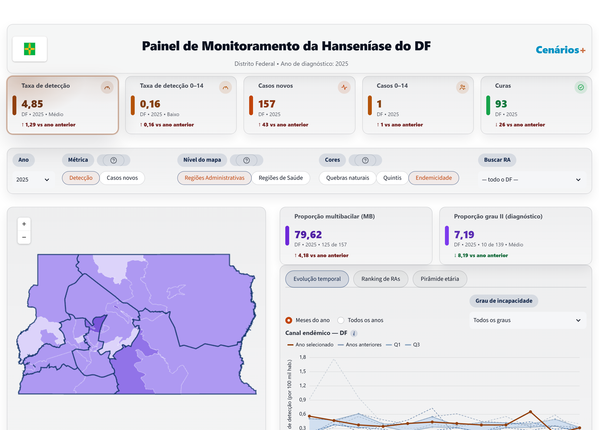

# Painel de Monitoramento da Hanseníase — Distrito Federal

[](https://github.com/Dev-Cenarios/painel-hanseniase-df/actions/workflows/ci.yml)


Painel de vigilância da hanseníase no Distrito Federal, contado como o boletim
da SES-DF, com mapa por Região Administrativa e Região de Saúde.

**No ar:** <https://painel.cenarios.unb.br/cenarios/hansedf/>



**Linhagem:** `cenarios-core` (a mãe: mapa, gráficos, contenção de falha) →
`modelo` (o esqueleto) → **este painel**. Nasceu em 28/out/2026 com
`modelo/scripts/novo_painel.py`. O que é comum à família se corrige no core
e chega aqui trocando o wheel de `vendor/`; o que é só deste painel mora aqui.

Hanseníase em residentes no DF, 2010 a 2025, contada como o boletim da SES-DF
"Situação Epidemiológica da Hanseníase no DF, 2021 a 2025" (ago/2026). O SINAN
do DF não tem RA: o mapa por RA e Região de Saúde vem da Tabela 1 dos boletins
(2020 a 2025).

A tela é a do hansepe (mesmas seções e o mesmo pack): quando o SINAN
georreferenciado chegar, basta calcular por área em `src/fonte_sinan.py` —
ver [`docs/desenvolvimento.md`](docs/desenvolvimento.md).

## Dados

Fora do git, em `data/origem/`. Precisam de VPN e do `.env` com as credenciais
do `cenarios_ai`:

```bash
python -m scripts.extrair_sinan_df        # silver.hanseniase, residentes no DF
python -m scripts.extrair_populacao_df    # public.pop_ibge do DF, por sexo e idade
python -m scripts.extrair_boletim_ra      # Tabela 1 dos boletins (baixa os PDFs da SES-DF)
python -m scripts.extrair_contatos_df     # contatos registrados/examinados (public.sinan_hans)
```

Distância ao boletim (silver de out/2026): casos novos de 2021 a 2025 dão
136 / 160 / 132 / 114 / 157 contra 130 / 158 / 130 / 113 / 157; abandono bate em
2024–2025; cura sai 3 a 8 pontos abaixo (há mais alta "Não informado" na
silver). Contatos examinados não sai: falta contatos registrados na fonte.

## Rodar

```bash
pip install -r requirements.lock.txt     # ou use o ../sinan/.venv
streamlit run app.py
pytest
```

## Deploy

Na VM, cada painel mora em `~/<slug>` com o `docker-compose.yml` dele:

```bash
cp .env.exemplo .env      # e ajuste PORTA e BASE_URL_PATH
# copie data/origem/ pra lá (o compose monta ./data)
docker compose up -d --build
```

**O compose recusa subir sem `.env`** — de propósito. Com um padrão de porta
ele subiria na porta de outro painel, que foi como o DFTB caiu em
14/out/2026. Sempre com `--build`: o código e o core estão dentro da imagem.
Depois do deploy, abra a página e confira um número: o healthcheck responde
mesmo com o script quebrado.

A rota no nginx (`/cenarios/hansedf/` → porta) só pode ser mexida por quem tem sudo na VM.
O passo a passo completo, do commit ao cartão da página inicial, está em
[`docs/publicacao.md`](docs/publicacao.md).

## Atualizar o cenarios-core

O core está em versão fixa, no wheel de `vendor/`. Para subir:

1. troque o wheel em `vendor/` pelo novo (`../cenarios-core/dist/`);
2. troque o nome dele no `requirements.lock.txt` e no `requirements.txt`;
3. rode a suíte e abra o painel; leia no README do core o que a versão muda.

## Estrutura

```
app.py                  a tela — só composição
src/
├── config.py           identidade: slug, título, território
├── dados.py            o contrato de dados: o que a tela pede, em que forma
├── fonte_sinan.py      as contas, do jeito do boletim
├── fonte_boletim.py    o mapa por RA, das tabelas do boletim
├── banco.py            conexão só leitura (só os scripts usam)
├── doencas/            o pack da hanseníase + o registro com o contrato
├── estilo.py           a ponte para a casca do hansepe
└── theme/              a casca do hansepe (tokens, cores, componentes)
scripts/                extração do banco e do boletim
geo/                    malha das 35 RAs e 7 Regiões de Saúde (do DFTB)
vendor/                 o cenarios-core, em versão fixa
tests/                  segredos, pack, dados (com o boletim), extração, app de
                        ponta a ponta, contexto do Docker
```

## Família Cenários+

| Painel | Repositório |
|---|---|
| Tuberculose — Brasil | [painel-tuberculose-brasil](https://github.com/Dev-Cenarios/painel-tuberculose-brasil) |
| Tuberculose — Pernambuco | [painel-tuberculose-pernambuco](https://github.com/Dev-Cenarios/painel-tuberculose-pernambuco) |
| Tuberculose — Recife | [painel-tuberculose-recife](https://github.com/Dev-Cenarios/painel-tuberculose-recife) |
| Tuberculose — Distrito Federal | [painel-tuberculose-df](https://github.com/Dev-Cenarios/painel-tuberculose-df) |
| Hanseníase — Brasil | [painel-hanseniase-brasil](https://github.com/Dev-Cenarios/painel-hanseniase-brasil) |
| Hanseníase — Pernambuco | [painel-hanseniase-pernambuco](https://github.com/Dev-Cenarios/painel-hanseniase-pernambuco) |
| Hanseníase — Distrito Federal | [painel-hanseniase-df](https://github.com/Dev-Cenarios/painel-hanseniase-df) |

## Como citar e licença

Se usar o painel ou o código num trabalho, use o botão **"Cite this
repository"** aqui no GitHub, que lê o [`CITATION.cff`](CITATION.cff).

O código é aberto, sob a licença [MIT](LICENSE): pode ser usado, copiado e
adaptado, desde que o aviso de copyright do Projeto Cenários vá junto. A
licença vale para o código. Os dados são do Ministério da Saúde, do IBGE e da SES-DF, e seguem as regras de cada fonte.
